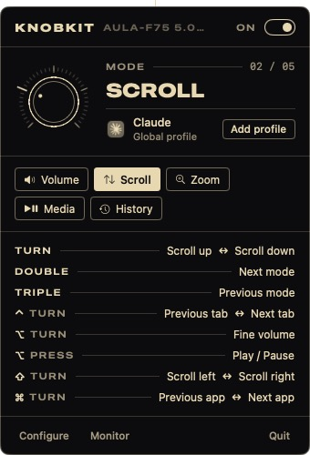
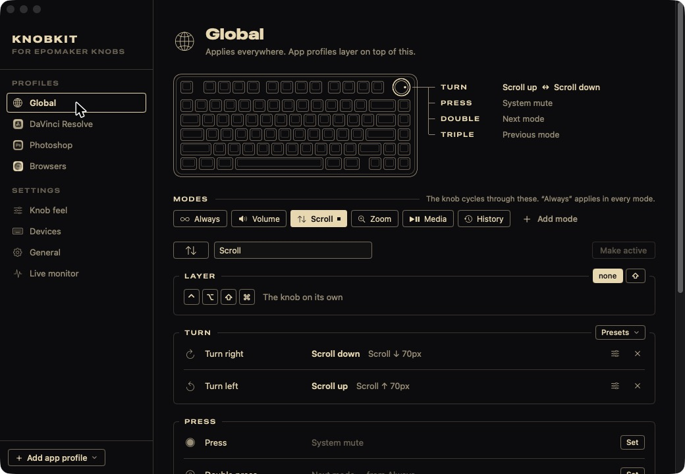

# KnobKit

A macOS menu bar configurator for the knob on Epomaker keyboards. It turns the
encoder knob into a context-aware control: what a turn, a press, a double press or a
triple press does depends on the frontmost app, the active mode, and which modifier
keys you are holding.

<p>
  
  
</p>

- Per-app profiles, with modes the knob cycles through (volume, scroll, zoom, media,
  history, or your own).
- A separate set of bindings for every combination of ⌃ ⌥ ⇧ ⌘ held while you turn.
- Actions from keystrokes and scrolling to menu items, shell commands, Shortcuts and
  macros.
- Only your keyboard's knob is remapped. The Mac's own volume keys keep working.
- Monitor level, mute, dim and mono on Universal Audio Apollo interfaces, which have
  no macOS volume control.

## Compatibility

KnobKit works with any keyboard whose knob reaches the Mac as volume up, volume down
and mute, which is how Epomaker's knob keyboards report out of the box. It is meant
for the whole Epomaker range.

It was built and tested on the **Epomaker x Aula F75 over Bluetooth**. Other models,
and the F75 over its 2.4G dongle or USB, are expected to behave the same way but have
not been tested. If you try one, please open an issue and say how it went.

Things that vary by keyboard:

- **Detection.** Keyboards whose name contains Epomaker or Aula are picked up
  automatically. For any other, open Devices, press **Find my knob** and turn the
  knob.
- **Long press and hold-and-turn.** The F75 sends a knob press as an instant tap, so
  these never fire on it. They are in the editor for keyboards that report the knob
  being held.
- **A remapped knob.** If the knob has been reassigned in VIA or the Epomaker driver,
  set it back to volume up, volume down and mute.
- **The drawing.** The keyboard in the configurator is the F75's 75% layout whatever
  model you use.

Requires macOS 14 or later.

## How it works

KnobKit never touches the keyboard's firmware. It works on the Mac side:

1. An **event tap** sees the volume and mute events before any app does and can
   swallow them. (Needs the Accessibility permission.)
2. A **HID listener** records which physical device sent each volume or mute press, so
   only your keyboard is treated as "the knob". The MacBook's own volume keys and
   other keyboards behave normally. It reads the consumer-control page only, never
   keystrokes. (Needs the Input Monitoring permission.)
3. A **gesture engine** turns ticks and presses into gestures, a **resolver** finds the
   binding for the current app, mode and modifier layer, and an **action runner**
   performs it.

Because the knob shares its signals with the keyboard's Fn media keys (Fn + volume
keys), those keys count as the knob too.

## Install

There is no packaged download yet: build it from source. You need Xcode (Swift 5.9 or
later).

```bash
git clone https://github.com/joelauge/KnobKit.git
```

```bash
cd KnobKit
```

Build, install to `/Applications` and launch (replaces a previous install):

```bash
scripts/install.sh
```

On first launch KnobKit opens its Devices page and asks for Accessibility and Input
Monitoring. Grant both, relaunch if asked, and turn the knob.

The build script signs with the first `Apple Development` identity in your keychain
so the permission grants survive rebuilds. Without one it falls back to an ad-hoc
signature, and macOS asks for the permissions again after every build. Set
`KNOBKIT_SIGN_IDENTITY` to choose an identity.

Open at login is the toggle under General, or from a shell:

```bash
/Applications/KnobKit.app/Contents/MacOS/KnobKit --login-item on
```

(`off` and `status` work too.) To build without installing, for development:

```bash
scripts/build.sh
```

```bash
open build/KnobKit.app
```

Run the logic tests with:

```bash
swift test
```

## Concepts

| Thing | Meaning |
| --- | --- |
| Profile | A set of bindings for one or more apps (by bundle id, `*` suffix matches a prefix, optional window-title filter). `Global` applies everywhere. |
| Mode | A named set of bindings inside a profile. The knob cycles through modes; the menu bar icon shows the active one. |
| Always | A per-profile layer that applies in every mode. |
| Layer | The modifier keys held while using the knob: none, or any combination of ⌃ ⌥ ⇧ ⌘. Each combination is its own set of bindings. |
| Gesture | Turn left / right, press, double press, triple press. Turns can also have a separate "spun fast" action. Long press and hold + turn depend on the keyboard (see Compatibility). |

Lookup order for any gesture: app profile's current mode, app profile's Always,
Global's current mode, Global's Always. Anything unbound falls through to the system
(volume / mute).

Out of the box: turning changes the volume, a press mutes, a double press goes to the
next mode and a triple press to the previous one.

### Actions

System default, do nothing, volume with a custom step, mute, any media or brightness
key, Apollo monitor level / mute / dim / mono (see below), keystroke (with repeat
count), keystroke with a held modifier (for ⌘⇥ / ⌃⇥ style switchers), type text,
scroll (pixels or lines, smooth, with modifiers), click a menu bar item by name, open
an app / file / URL, shell command, AppleScript, run a Shortcut, switch mode, and
macros (a sequence of any of these with delays).

Per binding: a label, "speed up when spun fast" (acceleration), "fire every N
detents", and a different action when spun fast.

Modes can also remap ordinary keys and shortcuts to any action. Key remaps apply to
every keyboard, not only the one with the knob.

## Universal Audio Apollo

Apollo interfaces have no macOS volume control, so the system volume keys (and an
unconfigured knob) do nothing on them. KnobKit talks to the UA mixer engine on this
Mac instead (TCP port 4710 on localhost, the channel UA Console itself uses) and
finds the output that carries the monitor level.

- **Apollo monitor level**: a step in dB per detent (0.5 dB resolution).
- **Apollo monitor mute / dim / mono**: toggles.
- **Ceiling** (General > Universal Audio monitor, default -20 dB): the knob never
  raises the level above this, however fast it is spun. A level already above the
  ceiling, set on the hardware, is left alone and can still be turned down.
- Both actions have "use the Mac's own volume when the current output has one", on by
  default, so the same binding works on headphones or built-in speakers.
- Changes made on the hardware or in UA Console are followed.
- General > "Use the Apollo for volume" rewrites Global's stock volume bindings to
  these actions; a fresh install does it automatically when the UA mixer is running.

The control protocol is not documented by UA and was tested with an Apollo x4 only.
If a UAD update changes it, the HUD shows "UA mixer not reachable" and nothing else
is affected. The UAD software must be running.

## Files

| Path | What |
| --- | --- |
| `~/Library/Application Support/KnobKit/config.json` | Everything: settings, profiles, modes, bindings. Readable JSON, safe to edit by hand; use General > Reload from disk afterwards. |
| `~/Library/Logs/KnobKit/knobkit.log` | Knob events, which device sent them, and what was done. Ordinary typing is never logged. |
| `Sources/KnobCore` | Config model, gesture engine, resolver, defaults. No UI, unit tested. |
| `Sources/KnobKit` | The app: event tap, HID listener, actions, HUD, menu bar panel, configurator. |
| `Sources/KnobKit/UI/Theme.swift` | The look: black, cream one-pixel lines, and the controls built on them. |

## Connections

Bluetooth, the 2.4G dongle and USB each present a keyboard as a different HID device.
Each one is remembered the first time it is picked, automatically or with Find my
knob.

## Testing without the knob

The Live monitor page has buttons that feed simulated knob input through the same
path as real events. From a shell, start the app with the hook enabled and send
tokens:

```bash
open build/KnobKit.app --args --allow-simulation
```

```bash
build/KnobKit.app/Contents/MacOS/KnobKit --send "cw cw opt+ccw press down wait:700 up"
```

Tokens: `cw`, `ccw`, `press`, `down`, `up`, `wait:<ms>`, each optionally prefixed with
modifiers (`cmd+shift+cw`). The hook is off unless `--allow-simulation` is passed.
With it on, `ui:snapshot`, `ui:shot` and `ui:hud:mode` write the menu panel, the
configurator window and the HUD to PNG files next to the log.

## Troubleshooting

**The knob only changes the keyboard's lighting, and the Live monitor stays empty.**
Some keyboards give the knob two modes. On the F75, in lighting mode (the knob's own
light breathes) turning changes backlight brightness and pressing cycles effects, all
inside the keyboard: nothing is sent to the Mac, so KnobKit has nothing to work with.
Hold the knob down for 3 to 5 seconds, until the Win and Caps Lock lights flash, to
switch to volume mode (the knob's light stays steady). The same long hold switches
back. Other models have their own way of switching; check the keyboard's manual.

**Events show up as "not the knob".** The device that sent them is not ticked under
Devices, or Input Monitoring is not granted. Use Find my knob.

**Turning feels too twitchy or too slow.** The speed thresholds under Knob feel were
measured on an F75 over Bluetooth. Watch the detents per second in the Live monitor
and adjust.

## Limits

- No firmware access: key matrix remapping, RGB lighting and on-board layers stay in
  Epomaker's own tools. KnobKit only acts on what the keyboard sends to the Mac.
- The knob cannot be told apart from the keyboard's own Fn volume / mute keys.
- A single press waits one double-press window (Knob feel) before acting wherever a
  double press is bound.
- Scroll actions go to whatever is under the pointer, as with any scroll wheel.
- Secure input fields (password prompts) block synthetic keystrokes by design.

## Licence

MIT. See [LICENSE](LICENSE).

KnobKit is an independent project. It is not affiliated with or endorsed by Epomaker,
Aula or Universal Audio; their names are used only to say what it works with.
